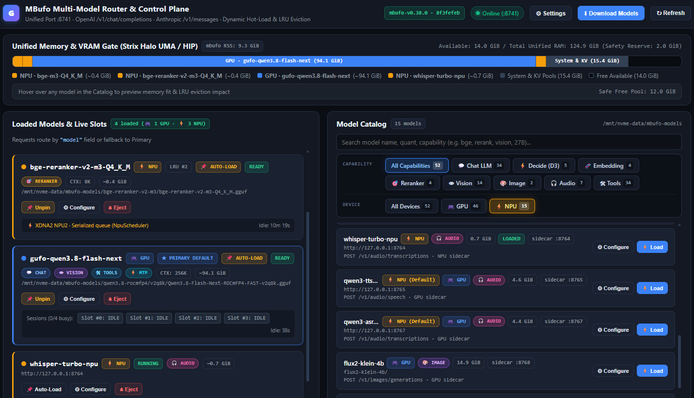

# MBufo

A high-concurrency inference engine for AMD Strix Halo (`gfx1151`), built for fair production serving across multiple models and quantization formats, with FlashAttention, Split-K decode attention and efficient KV-cache compression.

Originally derived from [gufo](https://github.com/gufo-org/gufo), since heavily rewritten.

> [繁體中文版](README.zh-Hant.md) · [简体中文版](README.zh-CN.md)



**Key features**

- **High concurrency**: a single Strix Halo node stays saturated with 16+ concurrent streams, each with up to 256K tokens of context (§1).
- **Fair scheduling**: prefill and decode share one mixed batch under anti-starvation scheduling, so no request is starved under load (§1).
- **Multiple models, one port**: 22 GPU + 9 NPU models served side by side, loaded and unloaded at runtime from the built-in `/admin` console (§3).
- **Multiple quantization formats**: K-quants, IQ4, MXFP4, ROCmFP4 and more; see [Supported Quantization Formats](#supported-quantization-formats) for each engine (§3).
- **FlashAttention and Split-K attention**: WMMA flash-attention prefill and Split-K decode attention keep long-context decode bandwidth-bound, from short prompts to 256K (§2).
- **Efficient KV cache**: blocked INT8 and compact 4-bit layouts that cut the memory each session holds (§2).
- **Low-precision compute**: quantized weights reduce memory traffic and cost (§2).
- **Speculative decoding**: MTP, DFlash and DSpark drafting (§1).

**Contents:** [Key Highlights](#mbufo-key-highlights) ·
[§1 High Concurrency Architecture](#1-high-concurrency-architecture) ·
[§2 Low-Precision Compute & Memory Optimization](#2-low-precision-compute--memory-optimization) ·
[§3 GGUF Coverage & Multi-Model Router](#3-gguf-coverage--multi-model-router) ·
[Quickstart](#quickstart) ·
[Benchmarks](#benchmarks-gfx1151-strix-halo) ·
[Build from Source](#build-from-source) ·
[Documentation Index](#documentation-index) ·
[Compatibility & Limits](#compatibility--limits)

---

## MBufo Key Highlights

| Highlight | Metric | What it means |
| --- | --- | --- |
| **Instant Response** | **Short-request TTFT 0.7 s** | An anti-starvation fairness scheduler guarantees that short queries arriving during massive 250K-token prefill batches begin generating in 0.7 seconds with bit-exact greedy outputs. |
| **Memory Efficiency** | **KV memory cut by ~50%** | The Blocked-Q8 cache holds a 262,144-token session in just 3.42 GB (compared to 6.44 GB for F16), with 4-bit value/key options reaching down to 1.81 GB. |
| **Unified Serving** | **23 GGUF model families** | A single HTTP port dynamically hosts and routes chat models, MoE, embeddings, and cross-encoders with zero-downtime hot swapping. |

> Figures in §1 and §2 other than the llama.cpp comparison (mixed batch, fairness, the engine comparison under load, int8 WMMA) come from earlier releases and are documented in `docs/MIXED_BATCH.md` and `docs/KV-V4.md`. The llama.cpp comparison and the Benchmarks section were measured again for this release.

---

## 1. High Concurrency Architecture

In high-concurrency serving, raw throughput is only half the equation. Usability under sustained load depends on two crucial metrics:

- **ITL (Inter-Token Latency)**: The gap between consecutive tokens once streaming has begun. Freezing active streams during long prefill cycles degrades interactive user experience.
- **Fairness**: No single session, client, or prompt may monopolize device resources. A 250K-token prompt arriving mid-conversation must not starve concurrent short chats.

While upstream bounds prefill chunks (`--prefill-chunk`) and prioritizes active decoders, traditional architectures still process chunks and decodes in separate sequential passes over the weights, introducing idle gaps. MBufo eliminates this bottleneck through deep pipeline fusion.

### Unified Mixed-Batch Path

MBufo merges the prefill chunk and decode rows into a single `ForwardBatch` and a shared attention kernel. Every cycle that advances a prefill chunk simultaneously outputs all due decode tokens:

- **2.1x lower token gap**: Streaming token intervals in a 5-row batch drop from 121 ms (two weight passes) to **57 ms** (single pass).
- **Reduced tail latency**: Under 16-way sustained serving, mean elapsed time decreases from 17.0 s to **15.3 s**, with noticeably smoother latency curves.
- **Sustained utilization**: Reaches 99% GPU utilization under 16 concurrent streams with 100% bit-exact outputs and zero errors.
- **Expanded batch envelope**: Scales up to 32 sessions and 1024 rows.

> Mixed batching changes when operations execute without modifying model semantics. It is enabled by default; setting `MBUFO_MIXED_BATCH=0` reverts to traditional scheduling. Architectural invariants and validation details are documented in [docs/MIXED_BATCH.md](docs/MIXED_BATCH.md).

### DecodeBatch & Split-K Attention

The serving layer advances decoders via prepared batches (`StepDecodeBatch` / `ExecutePreparedDecodeBatch`), and attention work routes through a unified Split-K decode reader (`blocked_splitk`). In shared Q8, Gemma 4 SWA layers and 27B attention layers decode with minimal overhead, while F16 paths remain fully bit-exact.

### Single-Stream Speed: Flash-Next and 27B

One request at a time on one Strix Halo node, cold KV, F16 KV, speculative decoding on (tok/s, measured through the HTTP server for this release). Full tables are in [Benchmarks](#benchmarks-gfx1151-strix-halo).

| Model | Prefill 2K | Prefill 32K | Prefill 128K | Decode (prose) | Decode (repetitive) |
|---|---|---|---|---|---|
| Flash-Next ROCmFP4 | 1733 | 1679 | 1585 | 54.4 | 78.0 |
| Flash-Next Q4_K_XL | 1719 | 1672 | 1587 | 52.1 | 81.7 |
| 27B Q4_K_XL | 533 | 525 | 382 | 24.6 | 55.7 |
| 27B FP4-FAST | 534 | 512 | 392 | 22.5 | 52.5 |

### Engine Comparison Under Load (MTP Enabled)

Benchmarked on identical hardware after warmup across concurrency levels 1 / 2 / 3 / 4 (Total TPS / Per-Session TPS):

| Engine | Total TPS | Per-Session TPS | Fairness A / B |
| --- | --- | --- | --- |
| A (Halogen) | 85 / 82 / 75 / 88 | 85 / 41 / 25 / 22 | 322 / 1140 |
| B (gufo) | 57 / 64 / 108 / 127 | 57 / 32 / 37 / 33 | 15 / 399 |
| **C (MBufo)** | **66 / 83 / 110 / 129** | **66 / 42 / 38 / 33** | **19 / 187** |

MBufo demonstrates superior linear scaling under multi-stream load (scaling smoothly up to 129 TPS with minimal per-session dropoff) while maintaining the best fairness scores.

### Anti-Starvation Fairness Scheduler

To prevent long prefills from degrading the responsiveness of short requests, MBufo employs three cooperative scheduling mechanisms:

1. **SRTF (Shortest Remaining Time First) Prefill**: Requests requiring ≤1 remaining chunk take precedence over long-prefill continuation chunks.
2. **Starvation Decode-Priority Preemption**: When incoming requests are queued for session slots, long prefill steps defer to resident decoders, rapidly clearing slots (bounded to ≤32 rounds to prevent prefill starvation).
3. **Near-Done Gating**: Preemption triggers only when an active decoder is within ≤64 tokens of its limit, avoiding unnecessary prefill delays when all sessions are generating lengthy outputs.

| Metric (gfx1151, FP4 + f16 + MTP + 4 sessions) | Result |
| --- | --- |
| Fairness-A degradation ratio | **160 → 0.7** |
| Fairness-B degradation ratio | **856 → 105** |
| Short-request TTFT | **3.4 s → 0.1 s** |
| ITL | Stable / Unchanged |
| Greedy output correctness | Bit-identical (verified by SHA checksums) |

### High-Efficiency Speculative Decoding

Coordinated through a unified Draft Registry across model families:

- **Flash-Next MTP**: Maintains high acceptance rates of **88.7% / 91.6% / 89.5%** across batch widths 2 / 3 / 4 without degradation as batch size increases, outperforming baseline throughput (97 / 111 / 133 tok/s).
- **27B DFlash2**: Fully compatible with Blocked-Q8 KV cache, writing directly to blocked sidecars with bit-exact continuity.
- **Gemma 4 MTP**: Async-GPU drafting with single-forward verification delivers **74–86 tok/s** decode at long contexts (`d=3` yields 1.74–1.78 accepted tokens/round).
- **Muse Glimmer DFlash**: Sustained end-to-end acceptance rate of **~89%**.
- **Inkling-2-Mini DSpark**: Loop-MoE (`h6-lbf16-UD-Q4_K_M`) + Vision (`mmproj-BF16`) with NeoX-RoPE RNN/GRU Markov head, WMMA Split-K verify & zero-rerun `sconv` snapshots; `h6-lbf16` + `dspark-BF16` (`-d 5`): **50.9 / 47.3 / 43.5 / 34.9 tok/s** at 4K/16K/30K/60K (65.8%–75.4% acc).

### Prefix RAM Cache & Production Session Profiles

- Reusable prompt prefixes are served directly from RAM cache (shared-prefix boundaries with customizable RAM limits).
- Multi-session scheduling is fully aligned, eliminating staircase delays and unlocking parallel throughput.

| Production Target | Configuration | Memory Budget (128 GB Unified) |
| --- | --- | --- |
| 16 streams, high concurrency | `--sessions 16 -c 65536 --kv-quant q8` | ~103 GB (~20 GB headroom) |
| 8 streams, long context | `--sessions 8 -c 131072 --kv-quant q8` | ~101 GB (~21 GB headroom) |
| 4 streams, max 256K context | `--sessions 4 -c 262144 --kv-quant q8` | ~101 GB (~21 GB headroom) |
| 1 stream, max 256K context | `--sessions 1 -c 262144 --kv-quant q8` | Lightweight footprint, peak throughput |
| 1 stream, unquantized precision | `--sessions 1 -c 262144 --kv-quant f16` | Full-precision KV cache |

---

## 2. Low-Precision Compute & Memory Optimization

MBufo delivers measured trade-offs between precision, speed, and memory. The recommended default is `--kv-quant q8` paired with ROCmFP4 or Q4_K weights.

### KV Cache: Blocked Q8 & 4-bit Compact Blocks

MBufo abstracts Blocked-Q8 KV into modular codecs, allowing Key and Value axes to be configured independently as 8-bit (34 bytes / 32 elements) or 4-bit (18 bytes / 32 elements) blocks. The shared compute core integrates blocked writers, direct readers, WMMA prefill readers, and Split-K decode readers.

| Mode | Status | Bytes/Position | 256K Single Session | Description |
| --- | --- | --- | --- | --- |
| `f16` | Baseline | 2048 B | 6.44 GB | Unquantized reference KV cache. |
| `q8` | **Recommended** | 1088 B | 3.42 GB | Blocked 8-bit, optimal quality and speed. |
| `q8` + `MBUFO_KV_V4=1` | Manual (K8V4) | 832 B | 2.62 GB | 4-bit Value, 8-bit Key. |
| `q8` + both flags | Manual (K4V4) | 576 B | 1.81 GB | 4-bit Key and Value for extreme memory constraints. |

- **Recommended: `q8`**: Provides full bit-level numerical integrity while cutting KV memory in half.
- **4-bit modes**: Designed for memory-constrained environments via environment variables; when unset, standard numerics remain unaffected. See [docs/KV-V4.md](docs/KV-V4.md).

### Weight Precision Implementations

- **ROCmFP4 / ROCmFP4-FAST**: 4.25 bpw single-scale FAST down experts decode through fp16 WMMA matrix cores, enabling MoE prefill on matrix hardware rather than generic fallback kernels. On gfx1151, FAST models match or exceed baseline prefill with improved decode speed.
- **MXFP4**: Native MXFP4 routed GEMM for GPT-OSS 20B / 120B with fused decode MoE / QKV / projection kernels; 120B supports zero-copy streaming uploads.
- **Q4_K**: UD-Q4_K_XL serves as the reference build for 27B and Flash-Next; bge-m3 includes a dedicated Q4_K_M loader.
- **W8A8**: Host-side 16-split varlen GEMM supporting Glimmer and Flash-Next prefill.

### Attention Kernel Accelerations

- **int8 WMMA Direct Prefill**: Single-session causal prefill reads blocked int8 KV directly without staging through F16 dequantization, delivering a **+30%** speedup (1085 → 1408 tok/s at 14K context).
- **Split-K Flash-Decoding**: Fused GEMV, fused Norm / Residual / Epilogue kernels, and device-side argmax.
- **Wide Prefill Coverage**: Applies fused projections and matrix core processing to all prefill batches exceeding vector width.

### Performance vs llama.cpp (gfx1151)

Same weights, greedy decoding, release builds, re-measured on one Strix Halo node against llama.cpp `5d9e5ac30`. MBufo is measured through its HTTP server, so its numbers include tokenization and request overhead; llama.cpp through `llama-bench` / `llama-server` at its best batch size. Prefill is a cold prompt of about 2K tokens; decode is generation at about 2K tokens of context. Speculative decoding is off. MBufo runs at its default blocked-Q8 KV cache, llama.cpp at F16 (the Benchmarks section below uses F16). Positive values mean MBufo is faster.

| Model (weights) | Prefill tok/s: MBufo / llama.cpp | Delta | Decode tok/s: MBufo / llama.cpp | Delta |
| --- | --- | --- | --- | --- |
| **Gemma 4 26B-A4B** (Q4_0) | 2689 / 1728 | **+56%** | 55.3 / 53.2 | +4% |
| **Qwen3.6-35B-A3B** (UD-Q4_K_XL) | 2130 / 1230 | **+73%** | 54.4 / 50.7 | +7% |
| **GPT-OSS 120B** (Q4_K_M) | 1226 / 1089 | **+13%** | 52.3 / 52.4 | 0% |
| **Muse Glimmer 30B** (UD-Q4_K_XL) | 516 / 398 | **+30%** | 12.6 / 13.2 | -5% |
| **DeepSeek V4 Flash** (IQ2_XXS mix) | 432 / 63 | **+586%** | 15.8 / 14.2 | +12% |
| **Laguna-XS-2.1** (Q4_K_M) | 1586 / 930 | **+71%** | 60.4 / 61.8 | -2% |
| **Laguna-S-2.1** (Q4_K_M) | 652 / 497 | **+31%** | 26.6 / 26.6 | 0% |

Embedding and reranking (one request through the HTTP server, lengths in tokens):

| Model (weights) | MBufo / llama.cpp | Delta |
| --- | --- | --- |
| **bge-m3** (Q4_K_M), 0.9K | 16651 / 5663 tok/s | **+194%** |
| **bge-m3** (Q4_K_M), 1.7K | 14101 / 5032 tok/s | **+180%** |
| **bge-m3** (Q4_K_M), 5K | 7426 / 3324 tok/s | **+123%** |
| **bge-m3** (FP16), 1.7K | 13895 / 4962 tok/s | **+180%** |
| **Qwen3-Embedding-0.6B** (Q8_0), 0.9K | 15481 / 7454 tok/s | **+108%** |
| **Qwen3-Embedding-0.6B** (Q8_0), 1.7K | 13981 / 5301 tok/s | **+164%** |
| **Qwen3-Embedding-0.6B** (Q8_0), 3.4K | 11356 / 4700 tok/s | **+142%** |
| **bge-reranker-v2-m3** (Q4_K_M), 64 documents | 76.9 / 38.0 docs/s | **+102%** |
| **bge-reranker-v2-m3** (FP16), 64 documents | 73.1 / 34.3 docs/s | **+113%** |
| **Qwen3-Reranker-0.6B** (Q8_0), 64 documents | 41.1 / 28.1 docs/s | **+46%** |

Notes:
- The DeepSeek V4 reference is the `deepseek4` support of this llama.cpp build, run at its default batch size of 512; the ds4 reference project was not available for this run.
- llama.cpp batch sizes: Gemma 4 and Glimmer at 2048, Qwen3.6 at 1024 (a 2048 run froze the test machine, so its best case may be higher), GPT-OSS through `llama-server` at 8192.
- bge-m3 accepts inputs up to its native 8192 tokens. Input lengths are bucketed to a small set of shapes (about 12% steps) with exact key masking, so requests of different lengths share tuned GEMM plans; tuned picks are cached on disk (`MBUFO_TUNE_CACHE`, default `~/.cache/mbufo/bge_tune_v1.txt`), and the first request of a new shape still pays its one-time tuning.
- Qwen3-Reranker: MBufo applies the prompt template the model requires (about 27% more tokens per document) and prefills the shared system / instruction / query framing once per request instead of once per document (identical scores). The `/rerank` of this llama.cpp build does not, and on a test set of 8 relevant and 40 unrelated documents it put none of the relevant ones in its top 8, while MBufo ranked all 8 first.

- EmbeddingGemma 2 (BF16, text path; `tools/convert/embeddinggemma2_to_gguf.py`) is not supported by llama.cpp, so there is no llama.cpp reference. MBufo's vectors match an independent PyTorch implementation (cosine 1.000000 on six texts of 4 to 908 tokens). Through the HTTP server a request takes about 10 ms for 15 to 23 tokens and 76 ms for 908 tokens (11.9K tok/s); the PyTorch implementation on this node's 32 CPU threads (FP32) needs 24.7 ms for 13 tokens and 364 ms for 908 tokens, because PyTorch with ROCm does not run on this machine.

---

## 3. GGUF Coverage & Multi-Model Router

### Supported Model Families

A single HTTP port hosts and routes across all supported families — 23 GPU families first, then 9 NPU entries below the separator line:

Which quantization formats each engine loads: [docs/QUANT_FORMATS.md](docs/QUANT_FORMATS.md).

| Model | Parameters | Speculative Draft | Architecture Highlights |
| --- | --- | --- | --- |
| **Qwen3.8 Flash-Next** (Primary) | 125B-A6B MoE | MTP | ROCmFP4-FAST / UD-Q4_K_XL, Blocked-Q8 KV |
| **Qwen3.8 27B** | 27B Dense | DFlash2 (inc. Q8) | Dense + MoE paths; UD-Q4_K_XL recommended |
| **Gemma 4 26B-A4B** | 26B-A4B | MTP (F16 mirror) | Native tool use, SWA shared Q8 layers |
| **Gemma 4 E4B / E2B** | 4B / 2B effective (per-layer embeddings) | — | Q4_0 QAT; PLE (Q6_K gather), shared-KV layers, 8 heads x d256/d512, WMMA large-head prefill |
| **Gemma-4-12B** | 12B Dense | — | K-quant preconversion & WMMA Q8 prefill |
| **Qwen3.5-35B-A3B** | 35B-A3B MoE | — | qwen35moe pipeline support |
| **Qwen3.6-35B-A3B** | 35B-A3B MoE | — | Q6_K→Q8_0 loading, Split-K decode MoE |
| **Ornith-1.5-35B-A3B** | 35B-A3B MoE | — | `qwen35moe` hybrid SSM/attention, ROCmFP4 / Q4_K_M + BF16 vision (`width=2048`) |
| **Tiel-Coder / Cyber-Tiel-Coder-35B-A3B** | 35B-A3B MoE | — | Ornith-1.5 (`qwen35moe`) agentic coding & abliterated cyber/CTF fine-tunes; Q3_K/Q4_K/Q5_K/Q6_K/Q8_0 (`-GGUF-MTP`) |
| **GPT-OSS 20B / 120B** | 20B / 117B MoE | — | Native MXFP4 GEMM; zero-copy streaming for 120B |
| **Muse Glimmer 30B** | 30B | DFlash (~89%) | ATEM tool calling, W8A8 / Q8_0 execution |
| **Llama-3.1-8B** | 8B Dense | — | Standard dense GQA support |
| **DeepSeek V4 Flash** | MoE (IQ2/Q2/Q8 mixed GGUF) | DSpark | MLA decode, ds4-parity kernels, ~81 GiB resident |
| **Inkling-2-Mini** | 26B-A5.4B Loop-MoE | DSpark (BF16 / Q8_0) | 3x looped core + `mmproj-BF16` Vision, WMMA Split-K verify, native tool calling |
| **Laguna 2.1 (XS / S)** | 33B-A3B / 118B-A8B MoE | — | Hybrid 1:3 Global (YaRN) / SWA-512 RoPE, softplus per-head gate, sigmoid+bias top-8/10 MoE + shared expert |
| **Qwen3-Embedding-0.6B** | 0.6B | — | Single-prefill pooled executor |
| **bge-m3** | 0.6B XLM-R | — | CLS pooling, Q4_K_M loader, hipBLASLt autotune |
| **EmbeddingGemma 2** | ~0.3B Gemma-4 encoder (text path) | — | Bidirectional attention: 20 sliding-window (+-512) and 4 full layers (head_dim 256 / 512), per-layer inputs, mean pooling, 768-d output |
| **bge-reranker-v2-m3** | Cross-Encoder | — | BERT dispatch, padded batching |
| **Qwen3-Reranker** | Cross-Encoder | — | Qwen dispatch, shared scoring heads |
| **Qwen3-ASR 1.7B** | 1.7B | — | BF16 safetensors, deterministic greedy decoding |
| **Qwen3-TTS 12Hz 1.7B** | 1.7B | — | BF16 safetensors, F32 waveform decoder |
| **Qwen-Image-2.1** | Diffusion transformer | — | BF16 safetensors, Qwen3-VL prompt encoder, RGBA VAE |
| **MiniMax H3** | 50-block BF16 transformer | — | HIP transformer, VisualVAE / AudioVAE, MP4 composition |

---

### ⚡ NPU Models (XDNA2 Strix Halo NPU)

| Model | Params | Format / Backend | HTTP Route | Status |
| --- | --- | --- | --- | --- |
| **D3-Lite / Nano / Mini / Turbo / Ultra** | 0.8B / 2B / 4B / — / — | Q4NX (flm NPU2) | `POST /v1/systemone` | ✅ Served (router proxy + admin cards; ⚡ DECIDE only, qwen3.8 stays CHAT) |
| **Whisper-V3-Turbo** | 0.8B | Q4NX NPU2 (5 xclbins) | `POST /v1/audio/transcriptions` | ✅ Served (proxy; 1.4 s audio → 2.3 s verified) |
| **EmbeddingGemma 2** | ~0.3B | Q8 bfp16ebs8 / Q4 q4nx | `/v1/embeddings` (NPU lane) | 🧪 Runtime verified (24-layer E2E cos > 0.993; engine seam wired, default kNone) |
| **bge-m3** | 0.6B XLM-R | Q8 / Q4 | `/v1/embeddings` (NPU lane) | 🧪 Runtime verified (64×1024 GEMM cos 0.999988; encoder cos 0.999924) |
| **bge-reranker-v2-m3** | Cross-Encoder | Q8 / Q4 | `/v1/reranking` (NPU lane) | 🧪 Runtime verified (score diff ~1e-5) |
| **Qwen3-ASR 1.7B** | 1.7B | Q8 / Q4 | `/v1/audio/transcriptions` (served via GPU sidecar) | 🧪 NPU runtime verified (cos > 0.967, top-1 match) |
| **Qwen3-TTS 12Hz 1.7B** | 1.7B | Q8 / Q4 | `/v1/audio/speech` (served via GPU sidecar) | 🧪 NPU runtime verified (wav produced, cos > 0.98) |
| **FLUX.2-klein-4B** | 4B DiT | Q8 / Q4 | test harness (PNG out) | 🧪 Runtime verified (E2E cos(pipe)=0.9485 q8; per-step v 0.978-0.999; no HTTP serving yet) |
| **Z-Image-Turbo** | DiT | Q8 / Q4 | test harness (PNG out) | 🧪 Runtime verified (E2E cos(pipe)=0.9918 q8, q8q4=0.985; no HTTP serving yet) |

### Supported Quantization Formats

Every engine reads GGUF directly; the formats below are what each one accepts (anything else is refused at load with the tensor name and format, never decoded as another format). Details, caveats and how each combination was verified: [docs/QUANT_FORMATS.md](docs/QUANT_FORMATS.md).

| Engine | Dense / attention weights | Routed experts |
| --- | --- | --- |
| **Qwen 27B / Qwen3.5-3.6 MoE** | Q8_0, Q4_K, Q5_K, Q6_K, Q3_K, IQ4_NL, IQ4_XS, IQ3_S, ROCmFP4, ROCmFP4_FAST, F16 / BF16 / F32 | Q4_0, Q4_1, Q5_0, Q5_1, Q8_0, Q2_K, Q4_K, Q5_K, Q6_K, IQ2_XXS, MXFP4, ROCmFP4, ROCmFP4_FAST |
| **Qwen3.8 Flash-Next** | Native: Q8_0, Q6_K, ROCmFP4 / FAST, MXFP4, F16 / BF16 / F32. Converted to Q8_0 at load: Q4_K, Q5_K, Q4_0, Q4_1, Q5_0, Q2_K, Q3_K, IQ4_XS, IQ4_NL | Q4_K, Q5_K, Q6_K, Q5_1, Q8_0, Q4_0, Q3_K, Q2_K, ROCmFP4_FAST, MXFP4 |
| **Gemma 4 (26B-A4B, E4B, E2B, 12B)** | Q4_0, Q8_0, Q4_K, Q5_K, Q6_K, F16 / BF16 / F32 | same (Q4_0 takes the fast MoE path) |
| **GPT-OSS 20B / 120B** | Q8_0, Q5_0, Q4_K and F16 / BF16 / F32 attention | MXFP4 (native), Q4_0, Q8_0, Q5_1 (K-quants cannot encode its 2880-wide experts) |
| **Muse Glimmer, Llama-3.1** | Q4_0, Q8_0, Q4_K, Q5_K, Q6_K, F16 / BF16 / F32 | - |
| **DeepSeek V4 Flash** | the published mixed IQ2_XXS / Q2_K / Q8_0 recipe | same |
| **Inkling-2-Mini** | Q8_0, F16 / BF16 / F32, Q6_K→F16 output | NVFP4→Q4_0, Q5_K→Q8_0, Q8_0 |
| **bge-m3, rerankers, Qwen3-Embedding** | Q4_K_M and F16 loaders | - |
| **EmbeddingGemma 2** | BF16 (GGUF from `tools/convert/embeddinggemma2_to_gguf.py`) | - |

The embedding gather, row dequantization, row-dot kernels and host dequantizer share one registry (`core/quant/quant_traits.hpp`): F32, F16, BF16, Q4_0, Q4_1, Q5_0, Q5_1, Q8_0, Q2_K, Q3_K, Q4_K, Q5_K, Q6_K, IQ4_NL, IQ4_XS, IQ2_XXS, MXFP4, ROCmFP4, ROCmFP3. KV cache: F16, or blocked INT8 (Q8) at roughly half the memory with exact-continuity split-K attention.

### Production Multi-Model Co-Residency & `/admin` Control Plane

Running `serve llm --multi-model` turns MBufo into a **multi-model co-resident server** on a single unified port (e.g. `:8741` or `:8080`). Multiple heterogeneous GGUF models (MoE + Dense + Vision `mmproj` + Speculative `MTP`/`DFlash2` sidecars) remain **simultaneously resident in Strix Halo Unified Memory (UMA)** and serve concurrent requests in parallel without unloading each other.

#### Key Capabilities
- **Simultaneous Multi-Model Co-Residency**: Keep a flagship model (e.g. `Qwen3.8-Flash-Next` 94 GiB ROCmFP4-FAST) and fast secondary models (e.g. `Qwen3.8-27B` 13 GiB or `Gemma-4-26B`) loaded in UMA at the same time. Requests route dynamically by `"model"` ID or alias across both `/v1/chat/completions` and `/v1/messages`.
- **Embedded `/admin` Web UI Dashboard**: Open `http://<host>:<port>/admin` in any browser for:
  - **Sticky Unified Memory & VRAM Gate**: Real-time Strix Halo UMA breakdown (per-model footprint, KV/system pools, safety reserve) and single-line hover preview showing whether any catalog model fits alongside currently loaded models or requires LRU eviction.
  - **Live Session Slot Telemetry**: Inspect per-model session slots (`BUSY` / `IDLE`, cached KV tokens, idle duration), switch the Primary Default model with one click, or eject models gracefully.
  - **Local GGUF Catalog (`/admin/catalog`)**: Automatically scans `MBUFO_MODELS_DIR` (or model parent directories), groups multi-shard GGUFs, and auto-pairs Vision `mmproj` and `MTP`/`DFlash2` draft sidecars.
  - **Built-in Streaming Playground**: Test concurrent routing across loaded models in real time with TTFT and decode tok/s metrics.
- **Zero-Model Standby Startup**: Launch `mbufo serve llm --multi-model -p 8741` *without* `--model` (~86 MiB RSS) to start an empty control plane and load models on demand from `/admin`.
- **Memory Safety & Graceful Draining**: `/admin/load` enforces a UMA safety reserve (`MBUFO_MULTI_SAFETY_MIB`, default `2048` MiB). When memory is full, idle non-primary models are **LRU-evicted** automatically (or rejected with `409 insufficient_memory` if `"allow_evict": false`); the primary default model is protected. Ejected models drain in-flight requests before freeing GPU memory.

#### Available Endpoints

| Endpoint | Method | Purpose |
| --- | --- | --- |
| `/admin` | GET | Embedded Multi-Model Web UI Dashboard & Live Playground |
| `/v1/chat/completions` | POST | OpenAI Chat completions (routes by `"model"` ID/alias or falls back to Primary) |
| `/v1/messages` | POST | Anthropic Messages API (routes by `"model"` ID/alias or falls back to Primary) |
| `/v1/embeddings` | POST | Embeddings (bge-m3, Qwen3-Embedding, EmbeddingGemma 2) |
| `/v1/reranking` | POST | Reranking (bge-reranker-v2-m3, Qwen3-Reranker) |
| `/admin/models` | GET | List co-resident models, per-slot session telemetry, and UMA memory status |
| `/admin/catalog` | GET | Scan local GGUF repository and auto-discover `mmproj` / draft sidecars |
| `/admin/load` | POST | Hot-load a model into UMA alongside existing models (with optional LRU eviction) |
| `/admin/default` | POST | Switch the primary default model (`{"id": "<model-id>"}`) |
| `/admin/eject` | POST | Unload a model gracefully after in-flight requests finish (`{"id": "<model-id>"}`) |

---

## Quickstart

### 1. Launch Primary Inference Engine (Qwen3.8 Flash-Next)

```sh
./build/release/mbufo serve llm \
  --model models/qwen3.8-rocmfp4/v2q8k/Qwen3.8-Flash-Next-ROCmFP4-FAST-v2q8k.gguf \
  --mmproj models/qwen3.8-flash-next/mmproj-BF16.gguf \
  --mtp-model models/qwen3.8-flash-next/MTP/agentionai-MTP-Q8_0.gguf \
  --speculative mtp --think off \
  --served-model-name mbufo-qwen3.8-flash-next \
  --sessions 2 -c 262144 --kv-quant q8 -p 8741
```

### 2. Multi-Model Co-Residency Mode (`--multi-model` + `/admin` Web UI)

```sh
# Option A: Start with a primary model + enable multi-model router & /admin UI on :8741
./build/release/mbufo serve llm --multi-model \
  --model models/qwen3.8-rocmfp4/v2q8k/Qwen3.8-Flash-Next-ROCmFP4-FAST-v2q8k.gguf \
  --mmproj models/qwen3.8-flash-next/mmproj-BF16.gguf \
  --mtp-model models/qwen3.8-flash-next/MTP/agentionai-MTP-Q8_0.gguf \
  --speculative mtp --think off \
  --served-model-name mbufo-qwen3.8-flash-next \
  --sessions 2 -c 262144 --kv-quant q8 -i 0.0.0.0 -p 8741

# Option B: Zero-VRAM standby mode (no initial model; load everything from http://localhost:8741/admin)
MBUFO_MODELS_DIR=/path/to/models ./build/release/mbufo serve llm --multi-model -i 0.0.0.0 -p 8741
```

Open **`http://localhost:8741/admin`** in your browser to inspect Strix Halo unified memory, browse discovered GGUFs, hot-load co-resident models, and test live routing.

### 3. Multi-Model Co-Residency API Examples

```sh
# Hot-load a second model (Qwen3.8-27B) to co-reside alongside Flash-Next without evicting anything
curl http://localhost:8741/admin/load \
  -H "Content-Type: application/json" \
  -d '{
    "id": "qwen3.8-27b",
    "aliases": ["27b", "fast-dense"],
    "path": "models/qwen3.8-27b/Qwen3.8-27B-Q4_0_ROCMFP4_FAST.gguf",
    "max_context": 32768,
    "session_count": 1,
    "kv_cache_quant": "q8",
    "speculative": "off",
    "allow_evict": false
  }'

# Query both co-resident models simultaneously on the same port (:8741)
curl http://localhost:8741/v1/chat/completions \
  -H "Content-Type: application/json" \
  -d '{"model": "mbufo-qwen3.8-flash-next", "messages": [{"role": "user", "content": "Hello from Flash-Next!"}]}'

curl http://localhost:8741/v1/chat/completions \
  -H "Content-Type: application/json" \
  -d '{"model": "27b", "messages": [{"role": "user", "content": "Hello from co-resident 27B!"}]}'

# Switch primary default model, inspect loaded models & UMA telemetry, or eject a model
curl http://localhost:8741/admin/default -H "Content-Type: application/json" -d '{"id": "qwen3.8-27b"}'
curl http://localhost:8741/admin/models
curl http://localhost:8741/admin/eject -H "Content-Type: application/json" -d '{"id": "qwen3.8-27b"}'
```

MBufo is fully compatible with OpenAI SDKs, Open WebUI, and VS Code extensions. Point the base URL to `http://localhost:8080/v1`. Full API details are in [docs/SERVER.md](docs/SERVER.md).

---

## Benchmarks (gfx1151 Strix Halo)

Conditions (re-measured for this release, through the HTTP server): cold KV (unique prompt per request), `think` disabled, F16 KV, one session (`-j 1`), context 262,144. Speculative engines: 27B uses DFlash2, Flash-Next uses MTP. Prefill is the server-reported prompt rate; decode is the median of three runs of a 128 to 256-token completion, so it moves with draft acceptance.

### Prefill (tok/s, higher is better)

| Context Size | 27B Q4_K_XL | 27B FP4-FAST | Flash-Next ROCmFP4 | Flash-Next Q4_K_XL |
|---:|---:|---:|---:|---:|
| **2K** | 533 | 534 | **1733** | 1719 |
| **8K** | 551 | 515 | **1708** | 1678 |
| **32K** | 525 | 512 | **1679** | 1672 |
| **64K** | 467 | 479 | **1643** | 1637 |
| **128K** | 382 | 392 | 1585 | **1587** |
| **250K** | — | — | 1512 | **1518** |

### Decode (tok/s, speculative enabled)

| Scenario | 27B Q4_K_XL | 27B FP4-FAST | Flash-Next ROCmFP4 | Flash-Next Q4_K_XL |
|---|---:|---:|---:|---:|
| Prose generation (temp 0.4) | 24.6 | 22.5 | **54.4** | 52.1 |
| Fibonacci generation (temp 0.4) | 41.5 | 41.9 | **59.2** | 56.0 |
| JSON constraints (temp 0) | 43.8 | 44.3 | 63.6 | **64.2** |
| Greedy code /128 (temp 0) | 44.2 | 37.9 | 50.6 | **52.7** |
| Repetitive text /256 (temp 0) | 55.7 | 52.5 | 78.0 | **81.7** |

### Agentic Suite (agent_bench_v2 sandboxed tasks)

_Not re-run for this release: this table comes from an earlier build._

| Test Metric | 27B Q4_K_XL | 27B FP4-FAST | Flash-Next ROCmFP4 | Flash-Next Q4_K_XL |
|---|---:|---:|---:|---:|
| Tasks passed | **8/8** | 7/8 | 7/8 | 7/8 |
| Critical faults | **0** | **0** | **0** | **0** |
| Generation TPS range | 9.1–31.1 | 9.3–21.5 | 16.7–56.6 | 16.8–55.1 |

### Recommended Configurations

- **Qwen 3.8 27B**: **UD-Q4_K_XL** is the reference build; the two builds decode within about 15% of each other in the measurements above.
- **Qwen 3.8 Flash-Next**: **ROCmFP4** decodes as fast as Q4_K_XL (prose 54.4, fibonacci 59.2 tok/s) and fits in ~94 GB (saving ~17 GB over Q4_K_XL).

---

## Build from Source

Target environment: Linux x86-64 on AMD Strix Halo (`gfx1151`). Build commands are standard:

```sh
cmake --preset release -DCMAKE_INSTALL_PREFIX="$HOME/.local"
cmake --build --preset release --parallel 4
./build/release/mbufo diagnose
```

### Build Dependencies
- **Toolchain**: C++20 compiler (GCC 15.3 recommended), CMake 3.21+, Ninja, pkg-config.
- **Compute Libraries**: ROCm 7.2.3 SDK (HIP, hipBLAS, hipBLASLt, rocBLAS, hipCUB, rocPRIM, rocWMMA). Nix build is also supported (`nix build`).
- **System Libraries**: ICU, libcurl, OpenSSL, libpng, libjpeg, libwebp, FFmpeg.
- **Device Access**: Your user must have read/write permissions to `/dev/kfd` and `/dev/dri`.

For container configurations and system tuning, refer to the [upstream build guide](https://github.com/gufo-org/gufo#build-from-source).

---

## Documentation Index

| File | Summary |
| --- | --- |
| [docs/MIXED_BATCH.md](docs/MIXED_BATCH.md) | Mixed-batch design invariants, scheduling, and validation |
| [docs/KV-CACHE.md](docs/KV-CACHE.md) | Conversation cache and component lifecycle |
| [docs/KV-V4.md](docs/KV-V4.md) | 4-bit KV block layouts and accuracy measurements |
| [docs/SERVER.md](docs/SERVER.md) | HTTP API contracts and endpoints |
| [docs/CLI.md](docs/CLI.md) | Comprehensive command-line reference |
| [docs/DEVELOPMENT.md](docs/DEVELOPMENT.md) | Development workflow, presets, and local testing |
| [docs/TESTING.md](docs/TESTING.md) | Continuous integration and local quality suites |
| [docs/models/README.md](docs/models/README.md) | Model-specific configuration guides and benchmarks |
| [CHANGELOG.md](CHANGELOG.md) | Release history and changelogs |

---

## Compatibility & Limits

- **Semantic Invariance**: Mixed batching alters scheduling order, never model calculation logic. Any unsupported layer cleanly falls back to standard execution paths.
- **Precision Trade-offs**: `--kv-quant q8` trades minimal numerical divergence for major memory savings. If strict reference parity is required, use `f16`.
- **KV Format Isolation**: KV state snapshots are keyed to specific quantization formats to prevent cross-format reuse.
- **Model Advisory**: For Qwen 3.5 above 64K context, limit active tokens to 60K for driver stability; Gemma 4 full-512 layers run at F16.

---

readme-en-ptr## License & Credits

Upstream gufo is licensed under the MIT License. Notices for adapted code and dependencies are maintained in [NOTICE](NOTICE), [THIRD_PARTY_NOTICES.md](THIRD_PARTY_NOTICES.md), and `licenses/`.

MBufo started from [gufo](https://github.com/gufo-org/gufo). Thanks to gufo-org and its contributors, whose work on Q8 KV caching, int8 WMMA and speculative decoding laid the foundation for this project.
